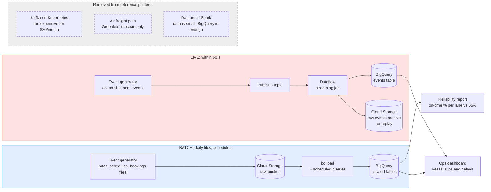

# Architecture: Greenleaf Foods (SHP04)

Targets: freshness 60 s, reliability 65% on time on every lane, budget $30/month. Ocean only.

| Box | Live or batch | Why |
|---|---|---|
| Shipment events, Pub/Sub, Dataflow, events table | Live | Warehouse teams re-plan when a vessel slips; freshness target is 60 s |
| Ops dashboard | Live | Reads the events table |
| Rates, schedules, bookings files, curated tables | Batch | Arrive as daily files; no sub-day need in the profile |
| Reliability report | Batch | On-time % per lane vs the 65% target is a historical measure |
